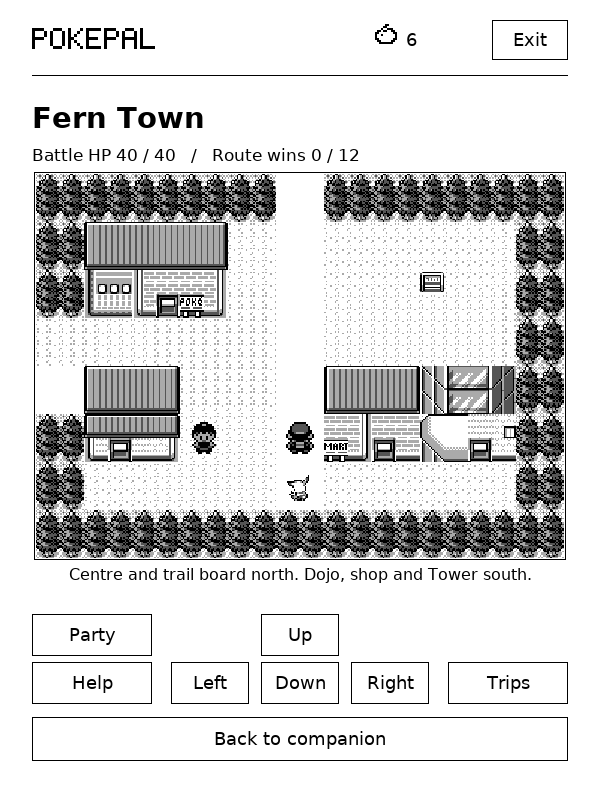
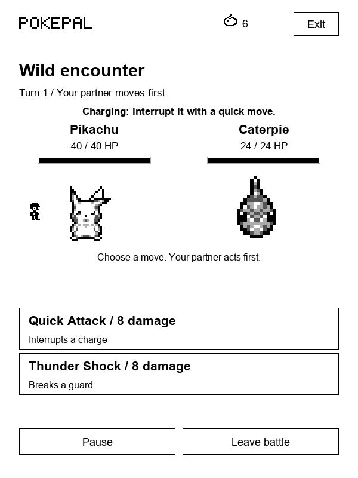
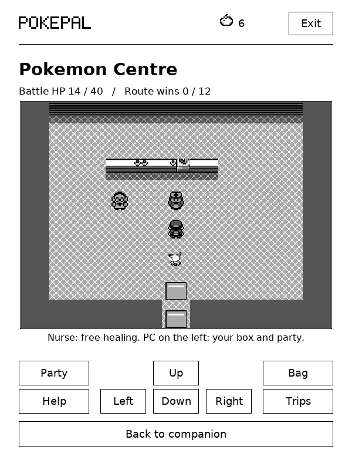
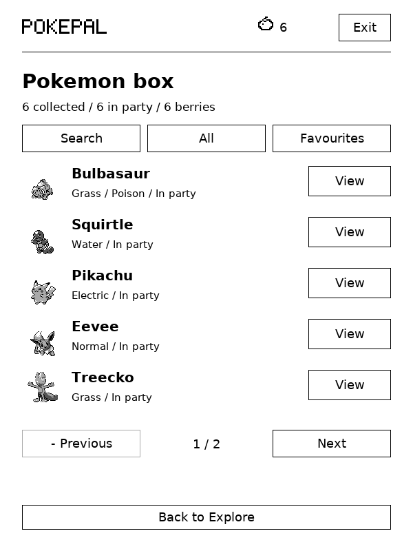

# PokePal for Kindle

A Pokémon pet for your Kindle. Feed it, play together and watch it grow.

[Download 1.1.0](https://github.com/itsParassharma/Pokepal-for-Kindle/releases/tag/v1.1.0) · [Watch the care demo](https://github.com/itsParassharma/Pokepal-for-Kindle/releases/download/v1.0.9/PokePal-trailer.mp4)

## Features

- Choose any of the 386 Pokémon from Kanto, Johto and Hoenn, with 11 quick starters.
- Feed, play, train, rest and clean. Collect daily berries, give your partner a nickname and watch it react to its mood.
- Every Pokémon has ten care animations and four-direction walking frames. Explore uses Crystal maps and trainers, with front and back Pokémon sprites in battles.
- Explore Fern Town and four wild areas, recruit Pokémon with berries, build a party of up to six and keep your collection in the PC box.
- Earn Gym badges and take on fresh trainer teams or a six-battle Tower run. Use two moves, switching and berry supplies to win.
- Earn berries and XP, hatch eggs and reach weekly goals as you read.
- Explore three different trails, find Pokémon and choose what happens on the way home.
- Help your partner evolve by building XP and bond.
- Discover favourite berries and watch your partner settle beside its decorations.
- Search your journal, save favourites and find friends ready to evolve. Earn 14 badges.
- Turn the screen off and let your Pokémon rest. KOReader can show your partner curled up beside its egg on the sleep screen.
- Choose larger text, stronger contrast or a small reading footer in settings.
- Everything works offline.

More:
[Reading rewards guide](docs/reading-rewards.md)
[Sleep screen setup](docs/companion-update.md#sleep-screen).

See [what changed in 1.1.0](docs/release-v1.1.0.md).

## Screenshots

| Fern Town | Turn-based battles |
| --- | --- |
|  |  |

| Pokémon Centre | PC box and party |
| --- | --- |
|  |  |

## Install with KOReader

You need KOReader installed on your Kindle.

1. Download and unzip **PokePal-v1.1.0-koreader.zip**.
2. Copy the `koreader` folder onto the Kindle drive. Merge it with the existing folder.
3. Restart KOReader. Choose **Open PokePal** in the welcome, or open **Tools > PokePal**.

You can assign **Open PokePal** to a gesture or QuickMenu. Hold **PokePal** in Tools for help, or read the [shortcut guide](docs/koreader-shortcuts.md).

---

With [Bookshelf](https://github.com/AndyHazz/bookshelf.koplugin) 6.0 or later, your partner can sit on the KOReader home screen. Add **PokePal** in the layout editor and tap it to play. Thanks to [AndyHazz](https://github.com/AndyHazz) for the module.

## Install with KUAL

You need a jailbroken touchscreen Kindle with KUAL installed. KOReader is not required.

1. Download and unzip **PokePal-v1.1.0-kual.zip**.
2. Connect your Kindle by USB. Copy the `extensions` folder onto the Kindle drive, next to `documents`. Merge folders if asked.
3. Eject your Kindle, then open **KUAL > PokePal > Play PokePal**.

## Saves

Both editions share your save. Use **More > Backups** to save or restore, and copy the `pokepal` folder to your computer before updating.

Opening Explore upgrades the save to version 8. Update both editions if you use both; 1.0.9 cannot read the upgraded save. Keep your backup if you plan to return to an older release.

[Save help](pokepal.koplugin/INSTALL.txt) · [Build and device notes](native/README.md) · [Credits](pokepal.koplugin/CREDITS.txt)

Unofficial fan project. Sprites by [SpriteCollab contributors](https://github.com/PMDCollab/SpriteCollab).
Pokémon belongs to its respective owners. Shared game code is MIT; the standalone host is GPL-3.0-or-later.
