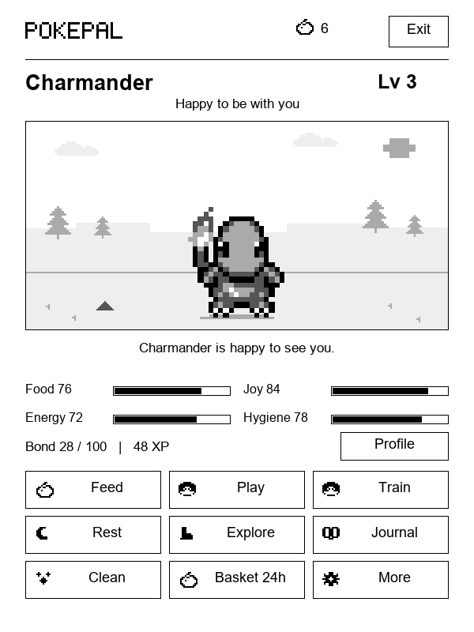
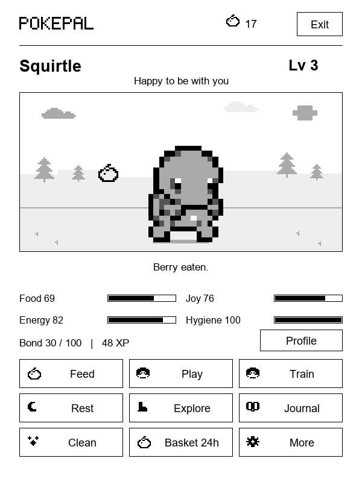
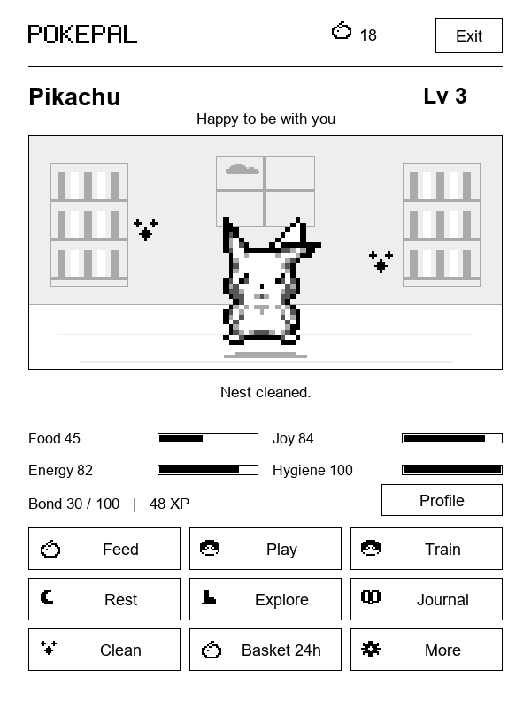
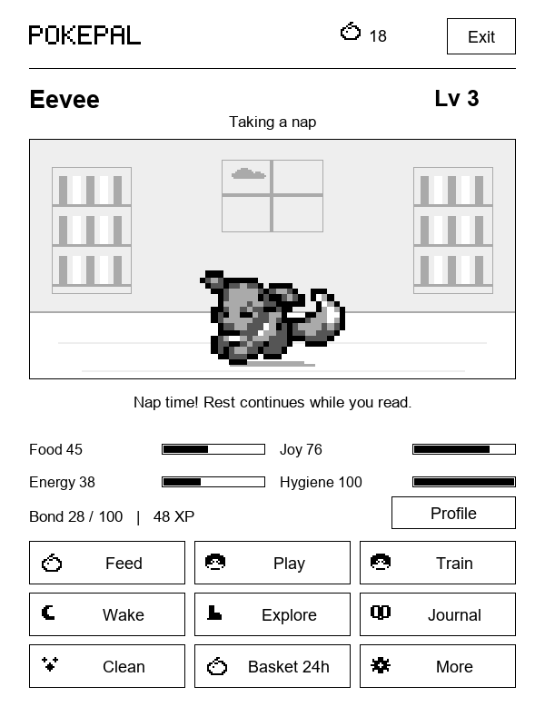
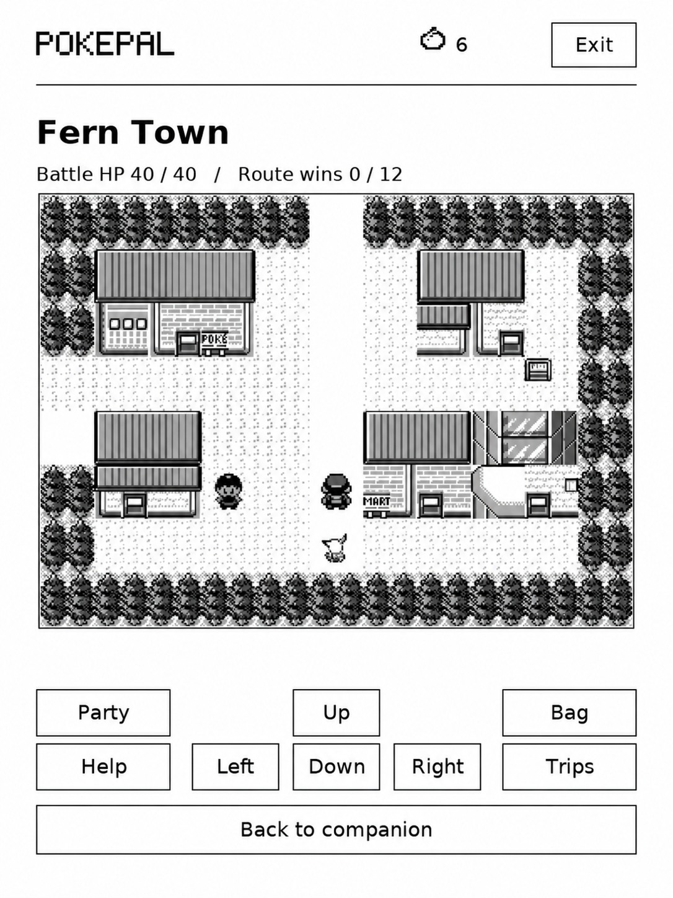
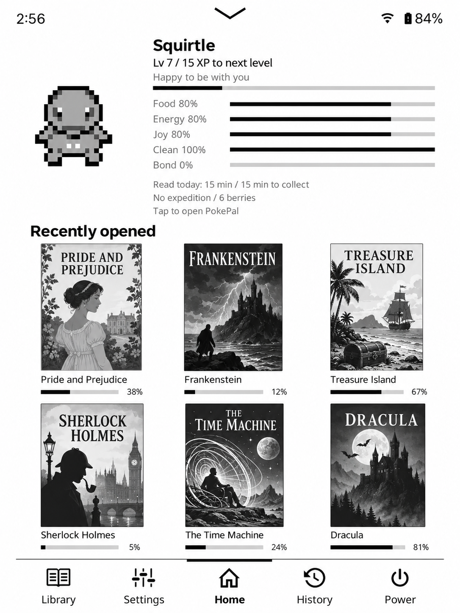
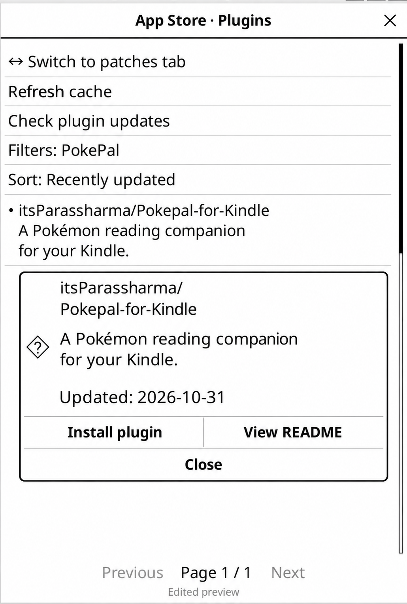

# PokePal for Kindle

A Tamagotchi-style Pokémon pet for your Kindle. Feed it, play together and watch it grow.

[Download 1.1.0](https://github.com/itsParassharma/Pokepal-for-Kindle/releases/tag/v1.1.0) · [Watch the care demo](https://github.com/itsParassharma/Pokepal-for-Kindle/releases/download/v1.0.9/PokePal-trailer.mp4)

## Features

- Choose any of the 386 Pokémon from Kanto, Johto and Hoenn, with 11 quick starters.
- Feed, play, train, rest and clean. Collect daily berries, give your partner a nickname and watch it react to its mood.
- Earn berries and XP, hatch eggs and reach weekly goals as you read.
- Explore three different trails, find Pokémon and choose what happens on the way home.
- Help your partner evolve by building XP and bond.
- Discover favourite berries and watch your partner settle beside its decorations.
- Search your journal, save favourites and find friends ready to evolve. Earn 14 badges.
- Turn the screen off and let your Pokémon rest. KOReader can show your partner curled up beside its egg on the sleep screen.
- Choose larger text, stronger contrast or a small reading footer in settings.
- Explore Fern Town and four wild areas, recruit Pokémon with berries.
- Earn Gym badges and take on trainers.
- Everything works offline.

More:
[Reading rewards guide](docs/reading-rewards.md)
[Sleep screen setup](docs/companion-update.md#sleep-screen).

See [what changed in 1.1.0](docs/release-v1.1.0.md).

## Screenshots

| Feed your partner | Keep the nest clean |
| --- | --- |
|  |  |

| Rest while you read | A walk through Fern Town |
| --- | --- |
|  |  |

## Install with KOReader

You need KOReader installed on your Kindle.

1. Download and unzip **PokePal-v1.1.0-koreader.zip**.
2. Copy the `koreader` folder onto the Kindle drive. Merge it with the existing folder.
3. Restart KOReader. Choose **Open PokePal** in the welcome, or open **Tools > PokePal**.

You can also find **PokePal** in [KoStore](https://github.com/ThePixelPro366/KoStore), the KOReader plugin browser. After installing, restart KOReader and open **Tools > PokePal**. See the [KoStore guide](docs/kostore.md).

**Kobo and other KOReader devices (experimental):** copy `pokepal.koplugin`
from the KOReader ZIP into your existing KOReader `plugins` directory, usually
`.adds/koreader/plugins` on Kobo. Reading rewards use KOReader sessions; the
native Kobo reader is not integrated. Saves use KOReader's settings folder.
Physical touch, sleep/wake and display behaviour still need device testing.

---

### KOReader integrations and discovery

Add your partner to [Bookshelf](https://github.com/AndyHazz/bookshelf.koplugin) or [SimpleUI](https://github.com/doctorhetfield-cmd/simpleui.koplugin), and find PokePal inside KOReader with the [App Store plugin](https://github.com/omer-faruq/appstore.koplugin). Tap any image to see it full size.

<table>
<tr>
<th>Bookshelf</th>
<th>SimpleUI home</th>
<th>KOReader App Store</th>
</tr>
<tr>
<td align="center" valign="top"></td>
<td align="center" valign="top"></td>
<td align="center" valign="top"></td>
</tr>
<tr>
<td valign="top">Add <strong>PokePal</strong> in the layout editor. Your partner sits on the shelf; tap it to play.  Screenshot: <a href="https://github.com/AndyHazz">AndyHazz</a>.</td>
<td valign="top">Choose <strong>Add module → PokePal</strong>. Your selected partner appears alongside your books.  Illustrative mockup with sample covers and reading progress.</td>
<td valign="top">With the <strong>App Store plugin</strong> installed, open <strong>Tools → App Store</strong> and filter for <strong>PokePal</strong>. After installing PokePal, restart KOReader and open <strong>Tools → PokePal</strong>.  Edited preview based on this <a href="https://i.redd.it/x962b8nl1v2g1.png">source screenshot</a>; not a device capture of PokePal.</td>
</tr>
</table>

SimpleUI support is tested with **3.0.1** and pinned main. It is available in the latest source, but **not in the v1.1.0 download yet**. See the [SimpleUI setup and Tiny Critter guide](docs/simpleui-tiny-critter.md).

### KOReader shortcuts

You can assign **Open PokePal** to a gesture or QuickMenu. Hold **PokePal** in Tools for help, or read the [shortcut guide](docs/koreader-shortcuts.md).

## Install with KUAL

You need a jailbroken touchscreen Kindle with KUAL installed. KOReader is not required.

1. Download and unzip **PokePal-v1.1.0-kual.zip**.
2. Connect your Kindle by USB. Copy the `extensions` folder onto the Kindle drive, next to `documents`. Merge folders if asked.
3. Eject your Kindle, then open **KUAL > PokePal > Play PokePal**.

## Saves

Both editions share your save. Use **More > Backups** to save or restore, and copy the `pokepal` folder to your computer before updating.

[Save help](pokepal.koplugin/INSTALL.txt) · [Build and device notes](native/README.md) · [Credits](pokepal.koplugin/CREDITS.txt)

Unofficial fan project. Sprites by [SpriteCollab contributors](https://github.com/PMDCollab/SpriteCollab).
Pokémon belongs to its respective owners. Shared game code is MIT; the standalone host is GPL-3.0-or-later.
