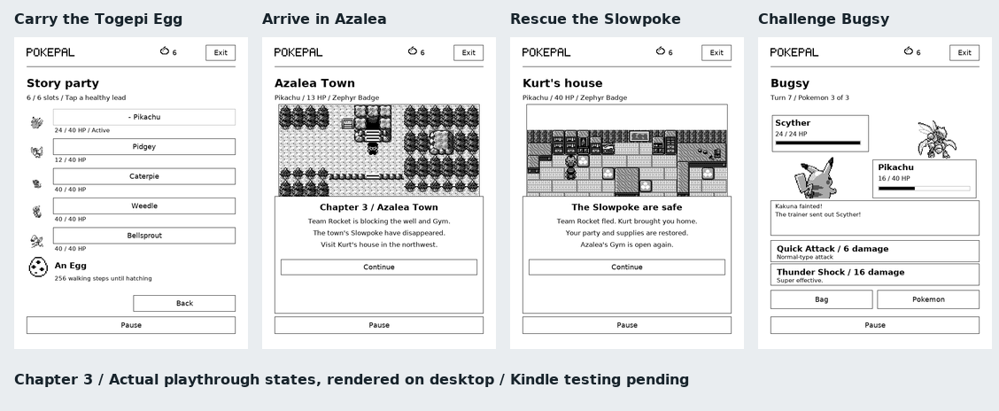
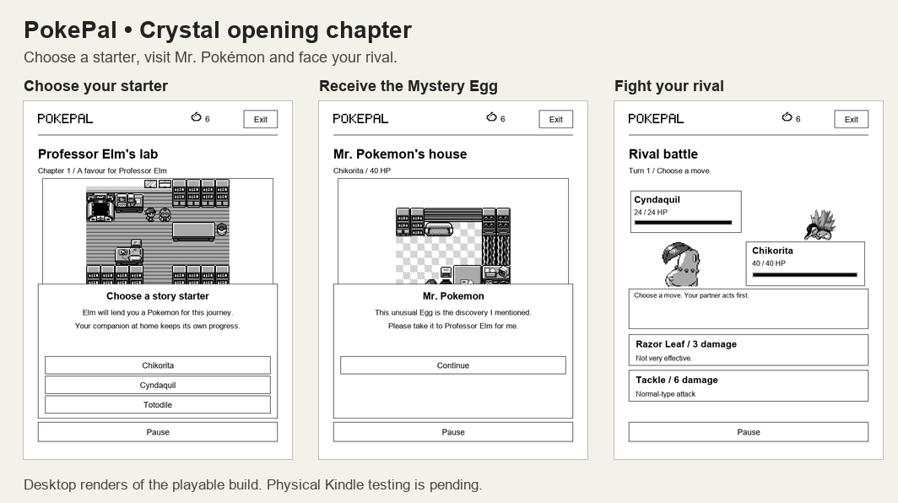
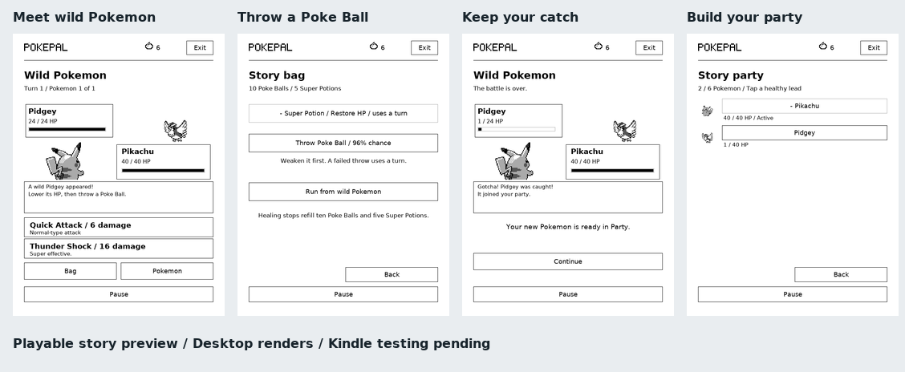

# Crystal story preview: through Azalea Town

Open **Explore → Story**. The Pokémon you chose in Tamagotchi mode becomes the trainer's first partner, with its nickname. There is no separate starter selection. Catch other Pokémon with Poké Balls to build your story party.

Chapter 1 follows Mom and Professor Elm's errand: visit Mr. Pokémon and Oak, face the rival and return the Mystery Egg. Chapter 2 continues along Routes 30 and 31 to Violet City. Climb Sprout Tower, meet the rival and Elder Li, then challenge Falkner for the **Zephyr Badge**. If you finished the earlier preview, leave Elm's lab and take Route 30's western path north.

**Chapter 3 begins after Falkner:** meet Elm's aide in Violet's Pokémon Centre. Take the Egg, follow Route 32 through Union Cave and Route 33, then visit Kurt in Azalea Town. Drive Team Rocket out of Slowpoke Well to reopen the Gym. Challenge Bugsy for the **Hive Badge**, face the rival on the western road and reach the Ilex Forest gate. The rival can also be fought before Bugsy, once the well is cleared.

The preview contains 27 original map layouts, including all three Sprout Tower floors, Union Cave's main floor, Slowpoke Well's first basement, two Gyms and four Pokémon Centres. Trainers use their source species rosters, including repeated Pokémon. Tap a trainer to battle. Defeated trainers step aside; Gym Leaders remain to talk. Falkner can also be challenged before the tower. Winning the well's final battle removes the remaining Rockets and brings your healed party back to Kurt's house.

## Playing

Tap a destination to walk or a person to talk. Use the directional buttons at a map edge to enter the next route. **Help** repeats the controls. Unsupported doors and routes explain the current boundary.

Walk through tall grass on Routes 29–33, the upper two floors of Sprout Tower, Union Cave or Slowpoke Well to meet wild Pokémon. Encounters use the device's local time: morning from 04:00, day from 10:00 and night from 18:00. Walking stops as soon as a battle begins.

In a wild battle, weaken the target, open **Bag**, then choose **Throw Poke Ball**. The bag shows the catch chance. A failed throw spends one ball and lets the opponent attack. A fainted Pokémon cannot be caught. **Run** safely leaves a wild encounter; trainer Pokémon cannot be caught. During a trainer battle, **Bag → Retreat from this battle** ends the attempt without a victory reward and lets you rest and change the team. The opening rival still lets the story continue after either outcome.

Caught Pokémon join your party until its six slots are filled; later catches go to the story box. **Party** changes your lead in the field. **Pokemon** switches during a battle and uses a turn, except when replacing a fainted lead. At any Pokémon Centre, **Party → Deposit / Open box** transfers Pokémon between your party and box. The preview keeps one of each species; already-owned species cannot be caught again.

Elm's aide needs **one empty party slot** for the Egg. If the party is full, deposit a Pokémon at that Centre and speak to him again. The Egg keeps that slot until Togepi hatches after **256 normal walking steps**; **Party** shows the remaining steps. This faster hatch schedule is a PokePal adaptation. Sleep, waiting, blocked steps and care-mode reading do not hatch the story Egg. If Togepi was already owned, hatching preserves that Pokémon and frees the Egg's slot without creating a duplicate.

Mom, the nurses, Mr. Pokémon and Kurt after the rescue restore the whole collection's story HP and refill **ten Poké Balls** and **five Super Potions**. These refills and the guaranteed escape are PokePal adaptations. A Super Potion restores up to 50 HP, capped by the story's 40 HP maximum, and uses a turn: the opponent can still hit back. Supplies belong to the story and do not spend care-mode berries. Rest between trainer battles when needed.

A trainer sends out each Pokémon in order. Each of your Pokémon keeps its own HP, and supplies carry through the fight. A fainted lead must be replaced if you have a healthy party member. Losing the whole party or drawing sends you to a Pokémon Centre without a victory flag; the trainer's full team is ready for a retry. The opening rival encounter still lets you continue after either outcome.

Elder Li awards a saved **HM Flash** milestone. Falkner awards the **Zephyr Badge** and Bugsy the **Hive Badge**. These story milestones do not add Explore badges or change care XP. The rival's Azalea team contains Gastly, Zubat and the evolved form of the starter family chosen in the opening. If neither move affects Gastly, switch to another Pokémon or retreat and adjust the party.

## Your companion and saves

Your care companion is copied into the story party **once, when the story starts**. Changing or evolving the care companion later does not replace your trainer's team. Catches, party order, HP, balls and box ownership belong to the story; they do not add care companions or alter the separate Explore collection. Nicknames are read from the shared companion record.

Earlier preview saves migrate when you open Story. Chapter 1 saves at the old starter menu or rival fight use your care companion; a paused starter menu resumes at Elm's directions. Chapter 2 saves keep their existing story partner. Catching-preview saves keep the entire party, box, HP, supplies and random state. These migrations preserve location, events, Mystery Egg, battle opponent and turn. A completed chapter stays complete.

Story data is stored within PokePal's existing atomic save. **Pause**, closing PokePal and sleeping stop movement. Returning resumes the same conversation or battle opponent and turn. Encounter and catch randomness is saved too. Failed saves block further actions, including spending balls or Potions and changing the party, until **Retry save** succeeds. Existing backup and restore tools include story progress. Care, reading totals, berries, XP and the separate Explore party are preserved.

## Installation

This is an unreleased source preview; v1.1.0 downloads do not contain it. Close PokePal before replacing its plugin folder and restart KOReader afterward. For native KUAL builds, the same Lua files and assets belong under `extensions/pokepal/game/`; use a complete matching build.

Copy your PokePal save folder off the device before installing. On Kindle it is `/mnt/us/pokepal/`, shared by KOReader and KUAL; on other KOReader devices use KOReader's settings directory. Opening this story upgrades the shared save to **version 12**. If you use both editions, update both together: older builds, including the previous chapter previews, cannot read version 12 saves and may recover an older snapshot. Keep the original backup if you plan to downgrade.

## Adaptation and limits

Map layouts, terrain, doors, route connections, trainer species rosters, wild encounter pools and species catch rates come from [pret/pokecrystal at 5c877ef](https://github.com/pret/pokecrystal/tree/5c877ef55197039c9676e8e3eec6d254b1c40fe8). Events use explicit Lua scripts with condensed dialogue. The rival's Pokémon is chosen once from the Johto starters, preferring a type advantage against your initial companion.

Battles use PokePal's existing two-move rules and artwork, with no guard or charging system. They use fixed story HP rather than care-mode levels and XP. A Ghost partner whose two attacks cannot hit a Normal opponent receives the existing Swift move in its second slot for that encounter. Catch chances use the normal-ball HP/rate calculation, without status bonuses. Trainer teams and type matchups are adapted; Crystal's exact levels, stats, PP, accuracy, status rules and AI are not implemented.

Any of the 386 care companions can be the first partner, but wild catches are limited to the species in these nine source encounter areas. Ilex Forest, Goldenrod and later chapters, deeper cave floors, fishing/Surf/Strength, Apricorn crafting, duplicate-species catches, shops, scripted NPC movement and the original phone system remain outside this preview. Flash's field effect and TM rewards are not implemented. The story reference is not a complete executable port.

## Verification

- Rule tests walk all three chapters and the tower's connected floors, saving and reloading after each step and event. They cover fourteen real legacy snapshots, all 386 starting companions, catching, day/night encounters, party and box transfers, Egg capacity and hatching, the well rescue, both Gyms, the rival's three team variants, retreat, repeat rewards, boundaries and corrupt saves.
- Battle simulations cover all 5,404 companion/trainer combinations in the first two chapters from full story HP and stocked Potions. The new chapter tests its 25 trainer positions with a saved party, including the twins' shared victory flag. Some matchups require another party member; the tests do not guarantee victory from any HP or inventory.
- UI tests cover touch actions, pause, sleep, stale callbacks, migration during reading sync and failed saves after catches and hatching. Maps, dialogue, battles, the bag, party and box are rendered at four screen sizes, two DPI settings and both text sizes. All 430 packed story images are decoded and checked.
- Native desktop and Linux KOReader tests exercise catching, party and box controls, Egg pickup and hatching, the well rescue, multi-Pokémon Gym fights and sleep lifecycle. Physical Kindle touch, refresh speed, ghosting and sleep/wake behaviour still need device testing. The images above are desktop renders.

Rebuild the maps, teams and encounter tables with `python tools/import_story.py /path/to/pokecrystal` at the pinned revision. Source hashes are in `pokepal.koplugin/assets/story/sources.json`. Original game artwork, layouts and story are credited separately from PokePal's code in `pokepal.koplugin/CREDITS.txt`.
