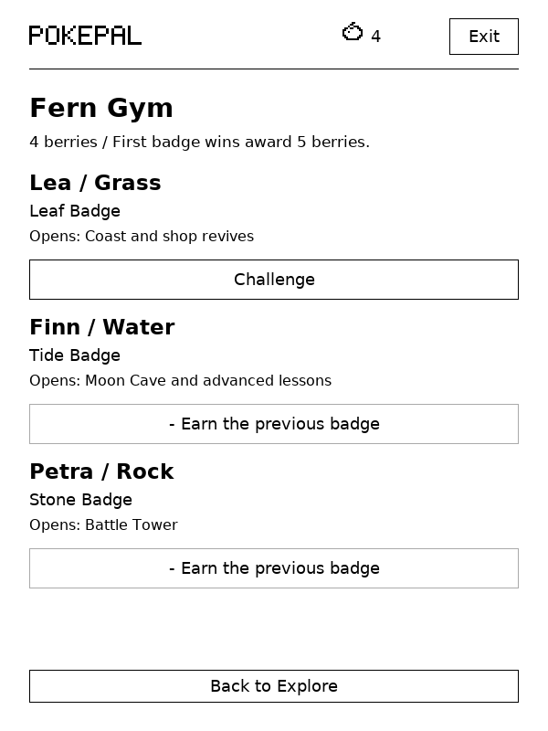
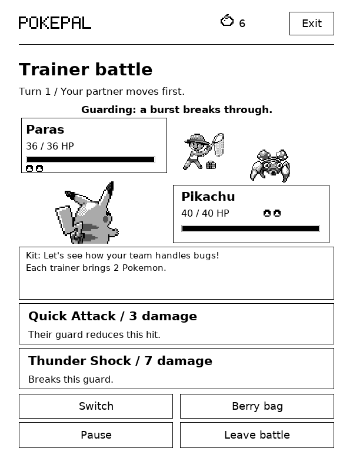

# Explore

Explore opens where you last stopped. Fern Town is your base; its north path leads to the meadow and Fern Woods. Visible Pokémon and trainers wait on the map, so you can approach an encounter or walk past it.

| Place | What you can do |
| --- | --- |
| Pokémon Centre | Heal the whole party for free; use the PC on the left to manage your box and party |
| Training dojo | Learn and equip moves, practise a battle, or open the existing care training |
| Trail board | Start the existing timed or reading expeditions |
| Shop | Buy potions and revives, choose an outfit and open the decoration shop |
| Fern Gym | Challenge three themed leaders; badges open routes and town services |
| Battle Tower | Bring your chosen party through five trainers and a boss; entry costs three berries |

Tap a destination or use the directional pad. Help lets you hide the pad. Each map fits on one screen and changes at an exit. The maps use Crystal tiles and directional trainer sprites. Battles show your Pokemon from behind and the opponent from the front, with HP boxes and party markers. All 386 Pokémon keep separate front, rear, left and right walking frames from the credited SpriteCollab sheets. Movement ends after reaching the destination; standing still schedules no animation.

Tap Party on any map to check each partner's HP and two equipped moves. Fainted partners are marked. The Centre still handles healing and party changes; you can equip moves there or at the dojo.

## Routes and neighbours

The first wild encounters are Caterpie, Rattata and Geodude in the meadow; Oddish and Hoothoot in the woods; Wingull and Krabby on the Coast; and Zubat and Aron in Moon Cave. After each encounter, that spot draws another Pokémon from its area's pool. All 386 species are reachable across the four areas. Visible encounters stay the same while you approach them and while the battle is saved.

Every trainer brings the same number of Pokémon as your party, from one to six. Route trainers, Gym leaders, the dojo coach and Tower trainers draw from pools suited to their themes. A new fight rolls a fresh team; your chosen party and equipped moves stay the same. Defeat each opponent before the trainer sends out the next. Rematches can repeat a Pokemon by chance. Only the active fight is kept in the save; there is no matchup history. Route trainers and Gym leaders remember your first victory and greet you differently on a rematch.

Speak to the town guide for three small quests:

- Find Mira's lost Pikachu in the woods and return it. This opens the Coast and the woods shortcut, and rewards four berries and a ranger outfit.
- Inspect the tracks in Moon Cave and report them to Theo. This opens the cave shortcut and gives you a plant for your room.
- Win a dojo practice battle to help Ari prepare for the Tower. Return for three berries.

Defeat the Coast trainer to open Moon Cave. Marked discoveries give a berry once. Quest rewards and first-win rewards cannot be claimed again.

The town guide shows each task's progress and reward. Once you finish an objective, its status changes to Return. Claiming the reward marks it Completed. Mira's Pikachu leaves the woods when you return it, and you can walk through its old spot.

## Your collection

Explore starts with the one Pokémon you chose. You can choose any of the 386 as your first companion. Party slots stay empty until you add members yourself, up to six.

To befriend a wild Pokémon, lower its HP to half or win the encounter, then offer three berries from the bag or result screen. The offer succeeds without a random failure. Your new friend goes into the box. The result screen lets you add it to an empty party slot; otherwise, it waits for you at the Centre. Opponents owned by trainers cannot be recruited.

The box stores one of each species. Search by species, nickname or number, filter by type, or show favourites. An “In party” marker identifies active members. At the Centre, you can withdraw, deposit or choose a lead. You must keep at least one party member. HP, learned moves, equipped moves, XP, bond and nicknames stay with each Pokémon. Hatched eggs and evolved companions also join the collection. Choosing a care companion at home uses this collection and does not replace your exploration party.

## Berries and badges

Berries pay for adventure supplies and progression. The daily basket, reading rewards and expeditions provide repeatable income. Discoveries, quests and first victories add rewards along the way. Playing never counts as reading time.

| Use | Cost |
| --- | --- |
| Befriend a wild Pokémon | 3 berries |
| Potion, restoring up to 16 HP | 2 berries |
| Revive, restoring a fainted member to 20 HP | 4 berries; requires Leaf Badge |
| Protect lesson | 2 berries |
| Drain strike lesson | 4 berries; requires Tide Badge |
| Battle Tower entry | 3 berries; requires Stone Badge |
| Ranger / Tower outfit | 5 / 8 berries |

Room decorations and eggs keep their existing berry prices. Centre healing, box storage, Gym challenges and practice are free, so running out of berries never strands you.

Fern Gym is northeast of the Centre. Beat its leaders in order. Each first victory awards five berries:

| Leader | Theme | Badge | Opens |
| --- | --- | --- | --- |
| Lea | Grass | Leaf | Coast and shop revives |
| Finn | Water | Tide | Moon Cave and advanced lessons |
| Petra | Rock | Stone | Battle Tower |

The existing quest and Coast-trainer route unlocks still work. Older saves with Tower runs retain access. Gym rematches do not pay the first-victory reward again.

## Two moves per Pokémon

Party battle HP is separate from care stats. Switching companions at home does not erase the party's injuries.

Each partner starts with two learned moves. Pikachu's family has Quick Attack and Thunder Shock; Squirtle's has Water Gun and Withdraw; Bulbasaur's has Vine Whip and Leech Seed. There are 20 more starting pairs:

| Pokémon line | Starting moves |
| --- | --- |
| Charmander | Ember, Smokescreen |
| Sandshrew | Scratch, Defense Curl |
| Zubat | Wing Attack, Leech Life |
| Oddish | Absorb, Acid |
| Abra | Confusion, Reflect |
| Machop | Karate Chop, Bulk Up |
| Geodude | Rock Throw, Defense Curl |
| Gastly | Lick, Night Shade |
| Vaporeon | Water Gun, Acid Armor |
| Jolteon | Pin Missile, Thunder Shock |
| Snorlax | Body Slam, Amnesia |
| Chikorita | Razor Leaf, Reflect |
| Totodile | Bite, Water Gun |
| Treecko | Quick Attack, Mega Drain |
| Torchic | Peck, Ember |
| Mudkip | Water Gun, Mud Slap |
| Lotad | Water Gun, Mega Drain |
| Shroomish | Mega Drain, Leech Seed |
| Aron | Metal Claw, Iron Defense |
| Spheal | Powder Snow, Defense Curl |

These pairs carry through each evolution. Zubat can interrupt a charge or recover HP. Geodude can break a guard or block an attack before countering. Shroomish can keep draining HP, but has no quick move to interrupt a charge. Pokémon without a family pair use Quick strike and a burst of their primary type.

The dojo teaches Protect for two berries and Drain strike for four. The Tide Badge unlocks Drain strike. These lessons spend berries without using care energy. Choose either equipped slot and tap a learned move to replace it. The two slots must contain different moves.

| Move kind | Effect and opening |
| --- | --- |
| Quick | Interrupts a charging opponent |
| Burst | Deals extra damage through a guard |
| Guard | Reduces incoming damage and strengthens the next hit after a successful block |
| Leech Seed | Drains up to three HP for three turns |
| Drain | Restores up to three HP when the hit deals damage |

The opponent shows whether it is attacking, guarding or charging before you decide. Move buttons tell you when a hit will interrupt that charge, break that guard or fail against an immune opponent. A defensive move shows how much damage you will take. Type advantages and immunities apply. Move effects follow PokePal's rules, including the family pairs and shared dojo moves.

The switch screen shows how much damage each partner will take and the HP they will have after that turn. It includes type immunity, Leech Seed and Tower healing bonuses. Voluntary switching uses a turn. Replacing a fainted partner is free: no enemy attack, seed tick or turn advance occurs during its entrance. A potion costs two berries, restores up to 16 HP and also uses a turn in battle. Potions cannot revive a fainted partner. A revive restores a chosen fainted party member to 20 HP and uses a turn during battle. After your active partner faints, choose a replacement before using the bag. The Centre heals everyone for free.

The first completed encounter at each wild spot gives one berry, three XP and one bond; befriending also counts. A first route-trainer victory gives three berries, three XP and one bond. The opponent is recorded in the journal. Recruiting after a win cannot pay the reward twice. Rematches and dojo practice do not pay battle rewards. Losing with the whole party sends you to the Centre. Leaving an encounter gives no reward.

## Battle Tower

Earn the Stone Badge and pay three berries to enter with your current party. The party begins at full HP. All partners use 40 HP and fixed move power, so care levels do not determine Tower strength.

Before a run, the Tower shows your party, their equipped moves and the first opponent's type. After a win, you can see the next opponent's type and attack type before choosing a benefit. You can also check the party's remaining HP from that screen.

There are five trainer battles followed by a boss. Each trainer gets a fresh team matching your party size, including the boss. After each of the first five wins, choose one temporary benefit:

- Restore 16 HP to the whole party.
- Improve defensive moves for this run.
- Restore three HP after a voluntary switch; repeated choices increase the bonus.

Health carries between battles. Outside supplies are unavailable during a run. A completed run awards a rank, six berries and a Tower outfit. Fleeing or a full-party defeat ends the run without those rewards.

Each turn and benefit choice is saved. Pause, close PokePal or put the Kindle to sleep, then use Explore to resume. Time spent playing stays separate from reading rewards. Existing reading rewards can still supply berries for adventures.

## Artwork

[Crystal](https://github.com/pret/pokecrystal) supplies the map tiles, human sprites and battle sprites for Pokemon 1-251. [Emerald](https://github.com/pret/pokeemerald) supplies battle sprites for 252-386. All are converted to four shades for the Kindle. The smaller field Pokemon use the existing credited SpriteCollab directions. Source revisions and hashes are in `assets/classic/sources.json`; `tools/import_classic.py` rebuilds the packs. The game needs no network access or additional Lua engine.

## Updating and testing

Back up the entire `pokepal` folder before trying this branch. Opening Explore upgrades the save to version 8. Version 5, 6 and 7 battles keep their opponent, turn and health until that fight ends. Existing town positions move to the central path only if a new building covers them. Migration adds your party and previously chosen companions to the box without changing the party. Encountered-only journal entries do not grant ownership. Older builds cannot read version 8; update both editions, or restore your backup before returning to 1.0.9.

Family move pairs update with this build. Learned dojo moves and equipped slot choices stay saved.

The game code is shared by KUAL and KOReader. Tests cover route navigation, party health, move learning, reward duplication, Tower reloads, failed saves, sleep, touch controls and larger text. The screenshots below come from the desktop test renderer. Physical Kindle refresh speed and touch response still need a device test.

| Box | Gym |
| --- | --- |
|  |  |

| Town | Party |
| --- | --- |
|  |  |

| Tower | Battle |
| --- | --- |
|  |  |

| Pokemon Centre | Same trainer, new team |
| --- | --- |
|  |  |

| Quest progress | Next Tower opponent |
| --- | --- |
|  |  |

The harbour town and mountain village remain later additions. This branch has one town with four outdoor areas.
