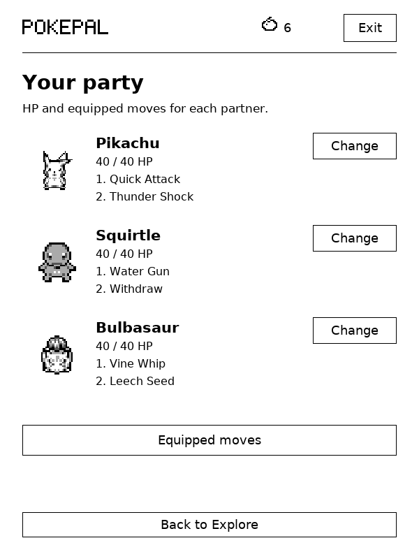
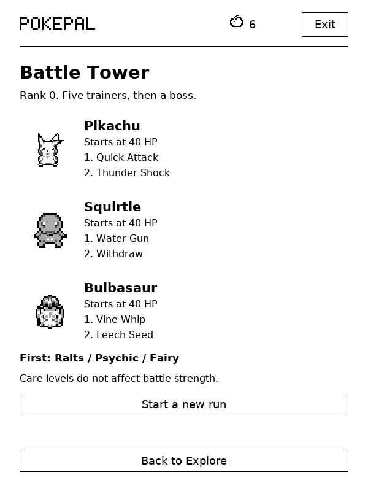
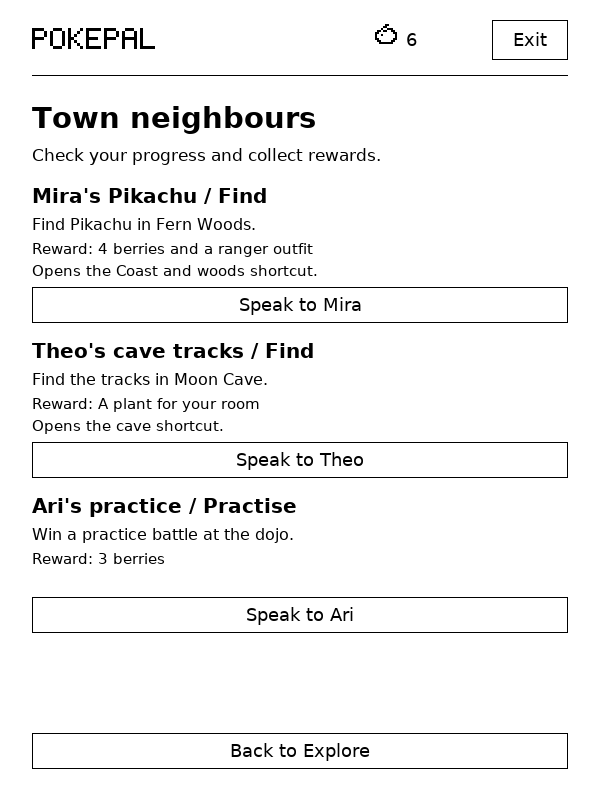
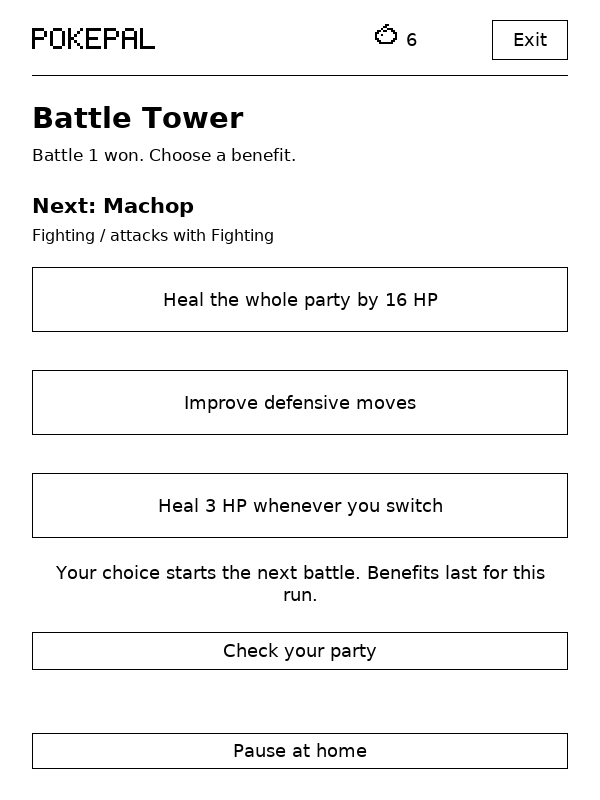

# Explore

Explore opens where you last stopped. Fern Town is your base; its north path leads to the meadow and Fern Woods. Visible Pokémon and trainers wait on the map, so you can approach an encounter or walk past it.

| Place | What you can do |
| --- | --- |
| Pokémon Centre | Heal the whole party for free; speak to the trainer on the left to choose three different Pokémon |
| Training dojo | Learn and equip moves, practise a battle, or open the existing care training |
| Trail board | Start the existing timed or reading expeditions |
| Shop | Buy potions, choose an outfit and open the decoration shop |
| Battle Tower | Bring three Pokémon through five trainers and a boss |

Tap a destination or use the directional pad. Help lets you hide the pad. Each map fits on one screen and changes at an exit. Trainers have standing, walking and battle poses. All 386 Pokémon have separate front, rear, left and right walking frames from the credited SpriteCollab sheets. Movement ends after reaching the destination; standing still schedules no animation.

Tap Party on any map to check each partner's HP and two equipped moves. Fainted partners are marked. The Centre still handles healing and party changes; you can equip moves there or at the dojo.

## Routes and neighbours

Fern Meadow has Caterpie, Rattata and Geodude. Fern Woods adds Oddish, Hoothoot and a trainer with Metapod. The Coast has Wingull, Krabby and a Staryu trainer. Moon Cave has Zubat, Aron and an Onix trainer.

Speak to the town guide for three small quests:

- Find Mira's lost Pikachu in the woods and return it. This opens the Coast and the woods shortcut, and rewards four berries and a ranger outfit.
- Inspect the tracks in Moon Cave and report them to Theo. This opens the cave shortcut and gives you a plant for your room.
- Win a dojo practice battle to help Ari prepare for the Tower. Return for three berries.

Defeat the Coast trainer to open Moon Cave. Marked discoveries give a berry once. Quest rewards and first-win rewards cannot be claimed again.

The town guide shows each task's progress and reward. Once you finish an objective, its status changes to Return. Claiming the reward marks it Completed. Mira's Pikachu leaves the woods when you return it, and you can walk through its old spot.

## Two moves per Pokémon

Choose three Pokémon at the Centre. All 386 are available. Party battle HP is separate from care stats, and switching companions at home does not erase the party's injuries.

Each partner starts with two learned moves. Pikachu's family has Quick Attack and Thunder Shock; Squirtle's has Water Gun and Withdraw; Bulbasaur's has Vine Whip and Leech Seed. There are 20 more starting pairs:

| Pokémon line | Starting moves |
| --- | --- |
| Charmander | Ember, Smokescreen |
| Sandshrew | Scratch, Defense Curl |
| Zubat | Wing Attack, Leech Life |
| Oddish | Absorb, Acid |
| Abra | Confusion, Reflect |
| Machop | Karate Chop, Bulk Up |
| Geodude | Rock Throw, Defense Curl |
| Gastly | Lick, Night Shade |
| Vaporeon | Water Gun, Acid Armor |
| Jolteon | Pin Missile, Thunder Shock |
| Snorlax | Body Slam, Amnesia |
| Chikorita | Razor Leaf, Reflect |
| Totodile | Bite, Water Gun |
| Treecko | Quick Attack, Mega Drain |
| Torchic | Peck, Ember |
| Mudkip | Water Gun, Mud Slap |
| Lotad | Water Gun, Mega Drain |
| Shroomish | Mega Drain, Leech Seed |
| Aron | Metal Claw, Iron Defense |
| Spheal | Powder Snow, Defense Curl |

These pairs carry through each evolution. Zubat can interrupt a charge or recover HP. Geodude can break a guard or block an attack before countering. Shroomish can keep draining HP, but has no quick move to interrupt a charge. Pokémon without a family pair use Quick strike and a burst of their primary type.

The dojo teaches Protect and Drain strike for two berries and six energy each. Drain strike becomes available after a wild or practice win. Choose either equipped slot and tap a learned move to replace it. The two slots must contain different moves.

| Move kind | Effect and opening |
| --- | --- |
| Quick | Interrupts a charging opponent |
| Burst | Deals extra damage through a guard |
| Guard | Reduces incoming damage and strengthens the next hit after a successful block |
| Leech Seed | Drains up to three HP for three turns |
| Drain | Restores up to three HP when the hit deals damage |

The opponent shows whether it is attacking, guarding or charging before you decide. Move buttons tell you when a hit will interrupt that charge, break that guard or fail against an immune opponent. A defensive move shows how much damage you will take. Type advantages and immunities apply. Move effects follow PokePal's rules, including the family pairs and shared dojo moves.

The switch screen shows how much damage each partner will take and the HP they will have after that turn. It includes type immunity, Leech Seed and Tower healing bonuses. Switching uses a turn, including when replacing a fainted partner. A potion costs two berries, restores up to 16 HP and also uses a turn in battle. Potions cannot revive a fainted partner. The Centre heals everyone for free.

A first win against each route opponent gives one berry, three XP and one bond to the battling partner, and records the opponent in the journal. Rematches and dojo practice do not pay battle rewards. Losing with the whole party sends you to the Centre. Leaving an encounter gives no reward.

## Battle Tower

Choose three different Pokémon before starting. The party begins at full HP. All partners use 40 HP and fixed move power, so care levels do not determine Tower strength.

Before a run, the Tower shows all three partners, their equipped moves and the first opponent's type. After a win, you can see the next opponent's type and attack type before choosing a benefit. You can also check the party's remaining HP from that screen.

There are five trainer battles followed by a boss. Trainer order and the boss change between attempts. After each of the first five wins, choose one temporary benefit:

- Restore 16 HP to the whole party.
- Improve defensive moves for this run.
- Restore three HP whenever a partner switches in; repeated choices increase the bonus.

Health carries between battles. Outside supplies are unavailable during a run. A completed run awards a rank, six berries and a Tower outfit. Fleeing or a full-party defeat ends the run without those rewards.

Each turn and benefit choice is saved. Pause, close PokePal or put the Kindle to sleep, then use Explore to resume. Time spent playing stays separate from reading rewards. Existing reading rewards can still supply berries for adventures.

## Updating and testing

Back up the entire `pokepal` folder before trying this branch. Opening Explore upgrades the save to version 6. Existing version 5 map and battle saves migrate with their turn and health intact. Older builds cannot read version 6; update both editions, or restore your backup before returning to 1.0.9.

Family move pairs update with this build. Learned dojo moves and equipped slot choices stay saved.

The game code is shared by KUAL and KOReader. Tests cover route navigation, party health, move learning, reward duplication, Tower reloads, failed saves, sleep, touch controls and larger text. The screenshots below come from the desktop test renderer. Physical Kindle refresh speed and touch response still need a device test.

| Town | Party |
| --- | --- |
|  |  |

| Tower | Battle |
| --- | --- |
|  |  |

| Quest progress | Next Tower opponent |
| --- | --- |
|  |  |

The harbour town and mountain village remain later additions. This branch has one town with four outdoor areas.
