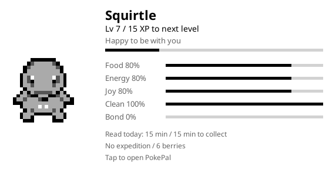

# PokePal on SimpleUI

Install the PokePal build from this PR alongside SimpleUI, restart KOReader,
then choose **Add module → PokePal** in SimpleUI's home-screen layout editor.
The card follows your selected partner automatically. No export, file copying
between plugins or separate companion selection is needed. Tap the card to
open PokePal; without a partner it invites you to choose one.

The existing v1.1.0 release does not contain these integrations. Both the card
and Tiny Critter export are tested with SimpleUI **3.0.1** and pinned main.

## PokePal card


The default compact view shows name, level, XP progress, mood and a useful
status line. In the module's settings, enable **Show care and progress** for
food, energy, joy, cleanliness and bond bars, today's reading, expedition
status, and an egg, evolution or weekly-goal message. Narrow columns stack the
partner above the text. Tap anywhere on the card to open the game; SimpleUI's
hold-to-configure and D-pad navigation remain available.

| Information | Where it comes from |
| --- | --- |
| Partner, nickname, level, XP and bond | PokePal's latest validated, committed save |
| Food, energy, joy, cleanliness and mood | Elapsed care calculated on a copy of that save |
| Expedition countdown | Wall time for timed trips; saved reading time for reading trails |
| Egg and weekly-goal progress | Saved game progress |
| Today's reading | Recorded PokePal reading history plus new KOReader reading counters |
| Reading time **to collect** / **pending** | New KOReader time that PokePal has not collected yet |

Open PokePal to collect reading rewards, hatch an egg or finish a trip. The
card does not grant XP, run a Kindle book scan, change a save, or claim that
pending time has already earned rewards. Returning from the game updates the
card to the newly saved totals. Reading rewards being disabled also disables
the pending-rewards display. Native Kindle reading appears after PokePal's
normal scan.

### Updates and animation

Updates are queued on KOReader's UI event loop after successful saves, after
reading-counter flushes, on return to the visible card and on wake. Multiple
notifications are combined into one read. A visible card also checks once a
minute, including for saves made by the standalone KUAL game. These are small,
deferred reads, not a separate thread or a daemon. Unchanged snapshots do not
request a repaint. No copies of game statistics are stored in SimpleUI.

**Animation** offers Off, Eco (2 frames) and Gentle (up to 4 frames), initially
following PokePal's animation preference. Existing animation PNGs are loaded
once per snapshot; no new frame files are written. A short sequence plays on
arrival or a partner/mood change, then rests. Eco uses 0.8 seconds per frame;
Gentle uses 0.45 seconds. Only the sprite rectangle requests an animation
refresh. Animation and polling stop when hidden, parked under the reader,
suspended or freed, and remain paused behind a lock screen.



The preview loops for demonstration; the device plays one sequence and rests.

The module uses SimpleUI's existing `Registry.register()` / `unregister()`
extension API. **No SimpleUI PR or patched SimpleUI files are required.**
PokePal registers itself as an available module and leaves your layout
untouched. Card options live in PokePal-owned KOReader settings. The card's
live display and animation use the screen context supplied by both tested
SimpleUI versions; other versions still need compatibility checks.

For stats or animation *inside SimpleUI's built-in Tiny Critter*, upstream
would need an optional companion-data interface and frame playback lifecycle.
This card does not replace Tiny Critter's speech, games, mood or quick-settings
display. You can use either or both integrations.

## Tiny Critter image export

PokePal can export its selected Pokémon as a SimpleUI custom critter. This is an
optional, one-way image integration. It uses existing PokePal animation stills
for all 386 Pokémon, with twelve transparent 64 × 64 PNGs per export.


This preview uses SimpleUI's own dialogue; the speech text is not from PokePal.

### Install and choose the critter

1. Install the PokePal build containing this integration in
   `koreader/plugins/pokepal.koplugin/`, then restart KOReader. The existing
   v1.1.0 release does not include this addition.
2. Use a SimpleUI build that includes **Tiny Critter**. The tested release is
   **3.0.1**. The repository's `3.0.0` tag does not contain the critter module.
3. Choose a partner in PokePal. Open **Tools > PokePal: SimpleUI >
   Tiny Critter image export > Export selected Pokémon**.
4. Add **Tiny Critter** in SimpleUI's home-screen layout editor and choose
   **Pokepal partner** in its **Critter** picker. In 3.0.1 this is in the module's
   settings; current main has shared **Settings > Tiny Critter** controls.
5. Reopen the home screen. If an older cached picture remains, reopen the
   Critter picker or restart KOReader.

PokePal does not enable the module or change your chosen SimpleUI critter.
You choose it yourself, and can switch back to any other critter at any time.

The exporter uses `DataStorage:getSettingsDir()`, not a hard-coded Kindle path:

| Destination below the KOReader settings directory | Content |
| --- | --- |
| `simpleui/sui_critters/pokepal_partner/neutral.png` | Required default image |
| `simpleui/sui_critters/pokepal_partner/<mood>.png` | Eleven optional mood images |
| `simpleui/sui_critters/pokepal_partner/.pokepal-owned` | Data-only ownership and image checksums |

Only the selected Pokémon is exported. There are no symlinks, external image
paths, executable phrase loaders or dependencies on the PokePal install path
inside this folder. It remains a usable static critter with PokePal disabled.

### What synchronizes in Tiny Critter

| Option | Behavior |
| --- | --- |
| **Export selected Pokémon** | Copies a snapshot of the committed PokePal save's selected partner. SimpleUI chooses its expressions. |
| **Keep Pokémon in sync** | Off by default. Updates the export after successful PokePal game saves and when KOReader starts or resumes while awake. |
| **Use PokePal mood image** | Off by default. Puts PokePal's current care/rest/trip pose into every mood image, so SimpleUI's dialogue cannot replace that pose. Applies immediately; subsequent updates require sync or another manual export. |

The selected partner follows PokePal's saved `species`, including evolution and
companion changes. With mood images enabled, an expedition maps to `playful`,
rest or low energy to `sleepy`, hunger or low joy to `sad`, dirt to `grumpy`,
high bond to `love`, and otherwise to `happy`. Elapsed care is calculated on a
copy of the save and never writes rewards, XP or progress back into the game.

The images are stills, not animated PNGs. Several moods share a pose; these are
existing Pokémon poses, not twelve separately drawn facial expressions.

The integration does **not** synchronize SimpleUI's conversational mood score,
dialogue, challenges, reading totals, XP or level. There is no two-way companion
selection and tapping the critter still opens SimpleUI's conversation. Those
features would need an agreed API or additional upstream hooks.

There is no background polling or forced screen refresh. A running standalone
KUAL game does not push updates into KOReader; export manually, restart, or
resume KOReader after the standalone game saves. A suspended/closed PokePal
instance does no automatic export. Time-based mood changes appear on the next
export trigger. The exported files are the compatibility contract; a guarded
call to an already-loaded SimpleUI `Assets.rescan()` also clears its image
cache, including two updates within the same filesystem timestamp second.

### Saves, settings and custom files

- PokePal reads its existing save through the normal validated loader. It does
  not change the save format, backup files, reading counters or save locks.
- SimpleUI preferences, stored mood, critters and decorations stay untouched.
  Two new PokePal-owned KOReader preferences remember sync and mood-image choices.
- An existing `pokepal_partner` folder without a valid ownership manifest, an
  edited generated image, an extra file, or a symlink blocks replacement. The
  error appears on manual export or under **About this integration**.
- Updates are staged beside the destination, then promoted as a directory.
  The previous export is retained until the promotion is synced. Interrupted
  swaps and cleanup are recovered on the next export. Neither plugin's saves
  are part of this transaction. Actual power-loss durability still depends on
  the device and filesystem.
- Turning sync off leaves the last image pack in place. To remove it, disable
  sync, choose another critter in SimpleUI and remove only `pokepal_partner`.
  For hand edits, first copy the pack to a differently named custom-critter
  folder and select that copy.

### Phrases and upstream versions

The [custom-critter documentation](https://github.com/doctorhetfield-cmd/simpleui.koplugin/blob/257c26d6685ced4fc2e895f98287b5f16f1d4f5e/docs/CRITTER.md)
describes a `phrases.lua` beside a critter's images. However, both tested sources
load custom phrases from the shared `simpleui/sui_critters/phrases.lua`, through
`Assets.phrasesFile()`. PokePal therefore writes **no phrase file** and leaves
your existing phrases intact. Per-critter dynamic dialogue is not claimed.

Compatibility was checked against upstream SimpleUI
[`3.0.1` / `e5cd6dc`](https://github.com/doctorhetfield-cmd/simpleui.koplugin/tree/e5cd6dcb31fa759b9831223d4719f61126367cff)
and [`257c26d` on main](https://github.com/doctorhetfield-cmd/simpleui.koplugin/tree/257c26d6685ced4fc2e895f98287b5f16f1d4f5e).

## Validation

`python tests/test_and_render.py` includes the exporter and game-save regressions.
`python tests/test_simpleui_assets.py` rebuilds and compares the packed assets,
decodes all 4,632 mood entries, checks size, grayscale and transparency, and
writes `tests/rendered/simpleui-moods.png` for inspection. Existing sprite
attribution and licences in `pokepal.koplugin/SPRITE-*` apply to these derivatives.
Regenerate the pack with `python tools/build_simpleui_assets.py`.

The real KOReader suite also runs the export regressions. In an unpacked
KOReader Linux v2026.07.1 runtime, the upstream test uses SimpleUI's actual
asset discovery, PNG decoder, sprite cache and complete critter row:

```sh
KO_HOME="$(mktemp -d)" SDL_VIDEODRIVER=dummy SDL_RENDER_DRIVER=software \
./luajit /path/to/PokePal/tests/test_simpleui_runtime.lua \
  /path/to/PokePal/pokepal.koplugin /path/to/simpleui.koplugin \
  /tmp/simpleui-preview.png
```

`tests/test_simpleui_module_runtime.lua` additionally runs the card against
each pinned upstream in the real KOReader runtime. It checks registration,
read-only care/reward separation, counters, corrupt saves and restore guards,
deferred/coalesced updates, bounded animations, overlays, narrow/detailed
layouts, suspend/park/free cleanup and tap-to-open. It then loads **both actual
plugins through KOReader's plugin loader**, mounts the card in SimpleUI's real
home screen, opens and closes PokePal, verifies collected XP on return, and
exercises repeated suspend/resume. CI includes these checks and the preview
ZIP. Screenshots and the animation above are from that Linux runtime.
The card's frames for all 386 partners are decoded by both upstream runs.
Regenerate the guide images from the runtime output prefix using
`python tools/build_simpleui_preview.py /path/to/simpleui-card`.

Physical Kindle testing is still needed for home-screen return after a partner
change, quick-settings reuse on newer SimpleUI builds, suspend/unlock ordering,
e-ink refresh/ghosting and animation power consumption, and interruption by USB
storage mode or power loss.
The desktop checks do not establish those hardware behaviors.
